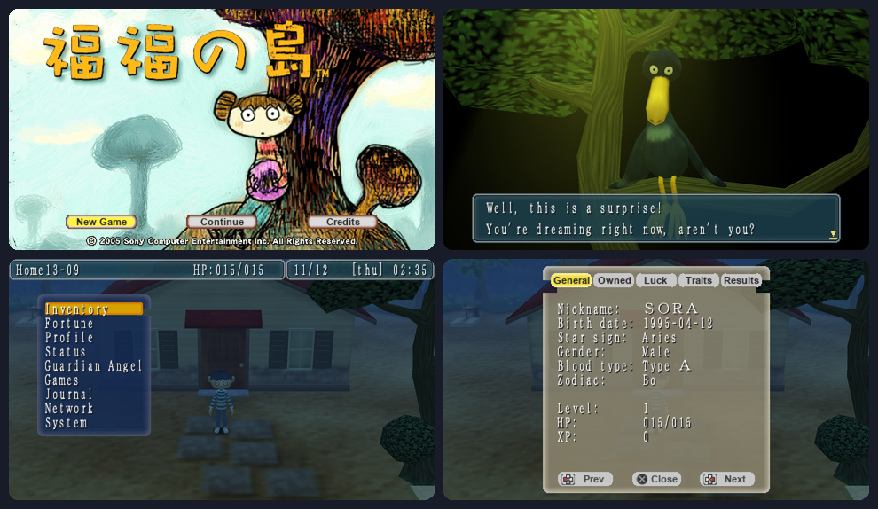
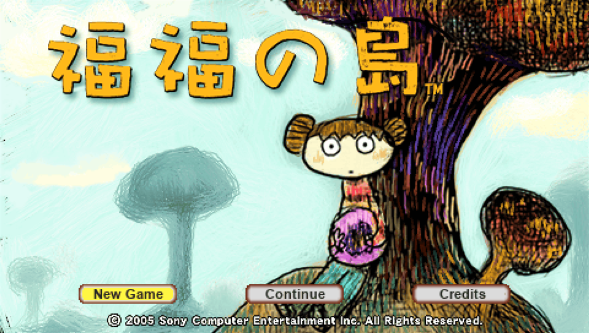
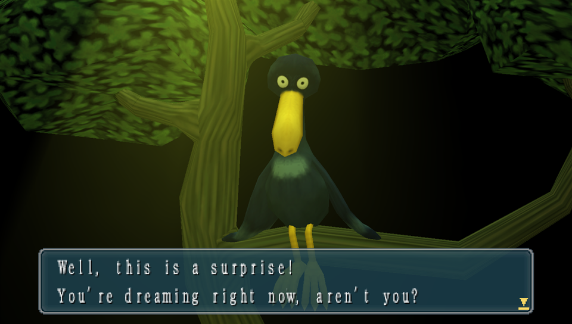
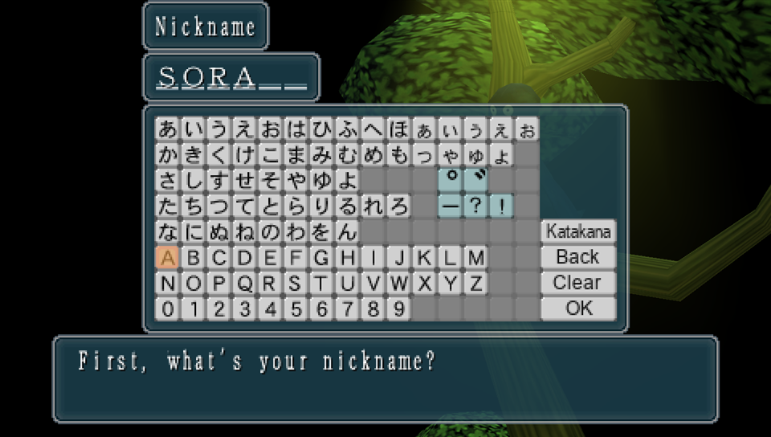
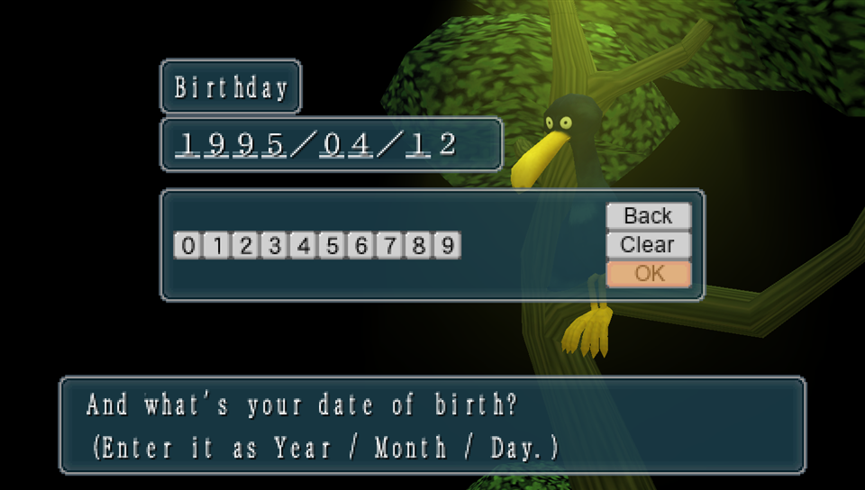
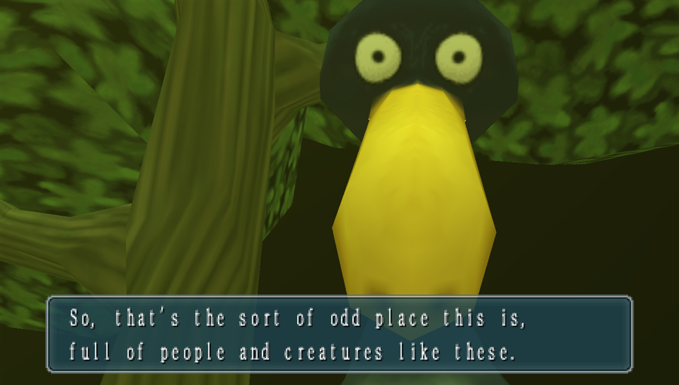
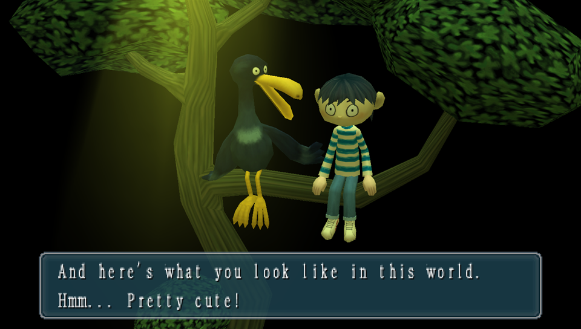
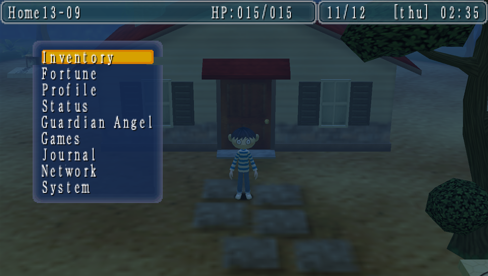
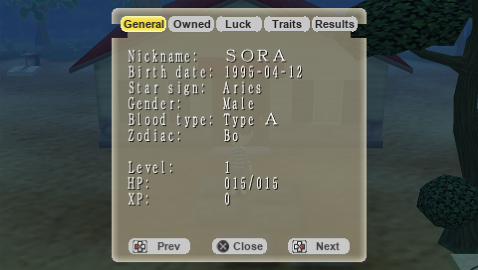

<h1 align="center">Fukufuku no Shima – English Patch (PSP)</h1>

<p align="center">
  <b>福福の島 · Fuku Fuku no Shima · "Fukufuku Island"</b><br>
  A fan-made English translation patch for the Japan-only PlayStation Portable game.
</p>

<p align="center">
  <a href="https://github.com/SAM2WOW/fukufuku-no-shima-english-patch/releases/latest"></a>
  
  
  <a href="LICENSE-GPL.txt"></a>
</p>

<p align="center">
  
</p>

<p align="center">
  <a href="#-download">Download</a> ·
  <a href="#-how-to-patch-your-iso">How to patch</a> ·
  <a href="#-how-to-play">How to play</a> ·
  <a href="#-screenshots">Screenshots</a> ·
  <a href="#-whats-translated">What's translated</a> ·
  <a href="#-faq--troubleshooting">FAQ</a> ·
  <a href="#-building-from-source">Build from source</a> ·
  <a href="#-credits">Credits</a>
</p>

---

**Fukufuku no Shima** (福福の島, often written *Fuku Fuku no Shima*) is a relaxing life game released by
Sony Computer Entertainment in Japan in 2005 (developed by MuuMuu, game ID **UCJS-10016**). You wake up on a
dreamy island full of fortune-tellers, quiz-loving princes, pompous skeleton henchmen and very opinionated
mushrooms, and spend your days chatting with them, collecting lucky items, getting your fortune told, solving
jigsaw puzzles, catching butterflies and slowly uncovering the island's secrets.

The game never came out in English. **This patch translates it**: all character dialogue, menus, items,
fortunes, trivia, newspapers and the main interface graphics. You only need your own copy of the Japanese
game and a free patching tool, and it works on **PPSSPP**, real **PSP** hardware and **PS Vita** (Adrenaline).

> [!NOTE]
> This is the first public release. The translation was produced with AI assistance and is being proofread.
> If a line reads oddly, text runs off a window, or something is still in Japanese, please
> [open an issue](https://github.com/SAM2WOW/fukufuku-no-shima-english-patch/issues) with a screenshot.

## 📥 Download

**[⬇ Download Fukufuku.no.Shima.English.xdelta](https://github.com/SAM2WOW/fukufuku-no-shima-english-patch/releases/latest/download/Fukufuku.no.Shima.English.xdelta)** (about 6.6 MB)

Release notes, checksums and older versions are on the [Releases page](https://github.com/SAM2WOW/fukufuku-no-shima-english-patch/releases).

The patch does **not** contain the game. You need your own ISO of the original Japanese UMD.

## 🛠 How to patch your ISO

The patch turns your Japanese ISO into an English ISO. It takes about a minute.

### What you need

- Your ISO of **Fukufuku no Shima (Japan)**, dumped from your own UMD with a PSP running custom firmware
  (see the [ConsoleMods PSP wiki](https://consolemods.org/wiki/PSP:PSP_Mods_Wiki) for how to dump a UMD).
- The `.xdelta` file from the [latest release](https://github.com/SAM2WOW/fukufuku-no-shima-english-patch/releases/latest).

### Step 1 – Check your ISO

The patch was made for this exact ISO. Other dumps (or an already-modified ISO) will not patch correctly.

| | Expected value |
|---|---|
| File size | `719,323,136` bytes |
| MD5 | `f4ade11283409fe9c524d10db1c1cee4` |
| SHA-1 | `e638abdff1cf32740c31d90d8fe144dc48f636b5` |
| CRC32 | `54ad85b6` |

How to check the MD5:

- **Windows**: open Command Prompt in the folder with your ISO and run
  `certutil -hashfile "Fukufuku no Shima (Japan).iso" MD5`
- **macOS**: open Terminal and run `md5 "Fukufuku no Shima (Japan).iso"`
- **Linux**: `md5sum "Fukufuku no Shima (Japan).iso"`

If your MD5 is different, see [My ISO has a different checksum](#my-iso-has-a-different-checksum).

### Step 2 – Apply the patch

Pick whichever option is easiest for you.

<details open>
<summary><b>Option A – Online patcher (any computer, nothing to install)</b></summary>

1. Open the **[xdelta online patcher](https://kotcrab.github.io/xdelta-wasm/)**.
   Everything runs in your browser; your files are not uploaded anywhere.
2. **Source file**: choose your Japanese `Fukufuku no Shima (Japan).iso`.
3. **Patch file**: choose `Fukufuku.no.Shima.English.xdelta`.
4. Click **Apply patch** and save the result as `Fukufuku no Shima (English).iso`.

</details>

<details>
<summary><b>Option B – Delta Patcher (Windows, macOS, Linux)</b></summary>

1. Download **[Delta Patcher](https://github.com/marco-calautti/DeltaPatcher/releases)** and open it.
2. **Original file**: select your Japanese ISO.
3. **XDelta patch**: select the `.xdelta` file.
4. Click the ⚙ (settings) button and tick **Backup original file**, otherwise your Japanese ISO is overwritten.
5. Click **Apply patch**. The patched ISO replaces the original file (the backup keeps the Japanese one).

</details>

<details>
<summary><b>Option C – Command line (xdelta3)</b></summary>

```
xdelta3 -d -s "Fukufuku no Shima (Japan).iso" "Fukufuku.no.Shima.English.xdelta" "Fukufuku no Shima (English).iso"
```

</details>

Keep your original Japanese ISO: future versions of the patch are applied to the original, not to an already
patched ISO.

## 🎮 How to play

| Where | How |
|---|---|
| **PPSSPP** (Windows, macOS, Linux, Android, iOS) | Open [PPSSPP](https://www.ppsspp.org/), go to the **Games** tab and open `Fukufuku no Shima (English).iso`. In the game list it shows up as *Fukufuku no Shima (English)*. |
| **PSP** with custom firmware | Copy the patched ISO to the `ISO` folder on your Memory Stick and start it from the XMB. |
| **PS Vita** with Adrenaline | Copy the patched ISO to `ux0:pspemu/ISO/` and start it from Adrenaline. |

**Controls**: ◯ confirm / talk, ✕ cancel, △ open the menu, D-pad / analog stick to move.
In PPSSPP's default keyboard layout that is **X** = ◯, **Z** = ✕, **S** = △, arrow keys = D-pad.

**Your name**: the name-entry keyboard keeps the original Japanese layout, but it has a full A–Z row, so you can
type an English name. Birthdays are entered as **Year / Month / Day**.

## 🖼 Screenshots

<table>
  <tr>
    <td></td>
    <td></td>
  </tr>
  <tr>
    <td align="center">English title menu</td>
    <td align="center">Fully translated dialogue</td>
  </tr>
  <tr>
    <td></td>
    <td></td>
  </tr>
  <tr>
    <td align="center">Name entry (type in English or Japanese)</td>
    <td align="center">Profile setup</td>
  </tr>
  <tr>
    <td></td>
    <td></td>
  </tr>
  <tr>
    <td align="center">Welcome to Fukufuku Island</td>
    <td align="center">Meet your island self</td>
  </tr>
  <tr>
    <td></td>
    <td></td>
  </tr>
  <tr>
    <td align="center">Main menu</td>
    <td align="center">Status screen</td>
  </tr>
</table>

## ✅ What's translated

| Part of the game | Status |
|---|---|
| Character dialogue (every NPC) | ✅ Translated |
| Opening quiz, trivia, maxims, daily fortunes, personality tests | ✅ Translated |
| Daily newspapers and bottle mail | ✅ Translated |
| Items, clothes, furniture, places, menus, system messages | ✅ Translated |
| Buttons, title menu, result banners (Pass!/Fail, Hit!/Miss, Start!/Finish!) | ✅ Redrawn in English |
| Loading-screen character bios (56 screens), qualification icons | ✅ Redrawn in English |
| Name-entry keyboard function keys | ✅ Translated (kana keys kept so Japanese names still work) |
| Crossword puzzles | ❌ Japanese – the puzzles are built on Japanese kana grids |
| Calligraphy rank certificates, network terms page | ❌ Japanese (text baked into images) |
| Signs painted on 3D models | ⚠️ Not checked yet |

**Known limitations**

- The status screen has room for only two letters of your Chinese zodiac sign, so it shows a short form
  (e.g. `Ho` for Horse). The full name appears everywhere else.
- Tested in PPSSPP 1.20.4 from the title screen through character creation into the island, the main menu,
  fortune menus and the status screen. Later parts of the game use the same text system but haven't all been
  played through yet – reports are very welcome.
- Fortune readings, personality results and newspapers are shown in small fixed windows, so their English is
  condensed to fit (v0.2).

## ❓ FAQ & troubleshooting

#### My ISO has a different checksum
Your dump differs from the one the patch was made for (different dump tool, a trimmed/compressed image, or an
ISO that was already modified). Try another dump, or build the English ISO directly from your copy with the
[build script](#-building-from-source), which patches the files inside the ISO and works with any intact dump
of the game.

#### The patched game shows garbage, crashes or won't boot
Almost always the wrong source ISO – the patcher can't tell, it just produces a broken file. Check
[Step 1](#step-1--check-your-iso), and make sure you patched the original Japanese ISO, not one that had already
been patched. Each release's notes list the size and MD5 of the patched ISO, so you can check the result too.

#### Can I use a CSO / compressed ISO?
Patch the uncompressed `.iso` first, then compress the result if you like.

#### Will my Japanese save files work?
The patch doesn't change the save format, so existing saves should load. Back them up first to be safe.

#### Is it the complete game?
Yes. The patch only changes text and images; nothing is cut.

#### Something is still in Japanese / text runs off the screen
Please [open an issue](https://github.com/SAM2WOW/fukufuku-no-shima-english-patch/issues) with a screenshot
and where it happened.

## 🔧 Building from source

You can build the English ISO yourself, for example to try your own translation changes. It only needs
**Python 3.8+**.

```
git clone https://github.com/SAM2WOW/fukufuku-no-shima-english-patch.git
cd fukufuku-no-shima-english-patch
```

Put `Fukufuku no Shima (Japan).iso` in the folder, then run:

- **Windows**: `build.cmd` (double-click it, or run it from Command Prompt)
- **Linux / macOS**: `./build.sh`

The English ISO is written to `build/Fukufuku no Shima (English).iso`. Add `--xdelta` to also create the
distributable patch, and `--strict` to stop on any text problem:

```
build.cmd --xdelta
./build.sh "/path/to/Fukufuku no Shima (Japan).iso" --xdelta
```

Lines that can't be inserted (too long for their slot, broken tags…) stay in Japanese and are listed in
`build/text_problems.txt`.

## 🤝 Contributing

Proofreading and bug reports are the most helpful contributions right now.

### Project layout

| Path | Contents |
|---|---|
| `text/` | One translation file per game file (UTF-8), mirroring the game's folder layout. |
| `textures/` | Edited images as PNG. `file.gma@1940.png` = the image at offset 0x1940 inside `file.gma`. |
| `glossary.md` | Character names, places and recurring terms – please keep translations consistent with it. |
| `docs/screenshots/` | Screenshots used in this README. |
| `tools/` | Build scripts (pure Python): ISO patching, text insertion, GIM image encoding, xdelta. |
| `tools/dev/` | Developer scripts that redraw the UI textures (need Pillow). |
| `tools/extract.py` | Re-creates `text/` from an original ISO, keeping existing English lines. |
| `tools/codex_translate.py` | The machine-assisted first-pass translator (fills empty `EN:` lines). |

### Editing text

Each entry in a `text/**/*.txt` file looks like this:

```
@5144 max=639
JP: よーう。あんた、<PN>やろ？<n>ハハ、ワイは何でも知っとるでー。
EN: Hey there! You're <PN>, right?<n>Ha ha! Nothing gets past me!
```

- `@5144` is where the text lives in the game file and `max=` how many bytes fit. Don't change these lines.
- Only edit the `EN:` line. An empty `EN:` keeps the Japanese.
- `<n>` = line break, `<p>` = new page (button press). Long lines are wrapped automatically at build time
  (44 characters, 2 lines per dialogue box).
- Keep all other tags exactly: `<PN>` = player name, `<UN>` = nickname, `<GN>` = skeleton number, `<NUM>`,
  `<ITEM>`, `<MONEY>` and similar insert values; `<col.RED>`…`</col>` changes colour.
- Use plain ASCII punctuation (`'` `"` `...`). ♪ and ★ are fine.
- `<SKIP>` means "never translate" (used for the name-entry keyboard's character tables).
- A few executable strings are shown by code that copies a fixed number of bytes. For those (marked with a
  `//` note) write `Full text||Short`: the full text is used wherever the game reads the string through a
  pointer, the short form where it copies it directly.
- Lines starting with `//` are notes for translators and are kept when the files are re-extracted.

Run the build afterwards; any line that is too long or has broken tags is reported in `build/text_problems.txt`.

### Technical notes

- Script files (`data/script/*.scb`) hold 520 opcodes of 40 bytes followed by 101 message slots of 640 bytes at
  0x5144, plus optional fixed-size data tables (quizzes, personality tests, fortunes). Text is Shift-JIS; the
  game renders ASCII with its half-width font (`start/fontA.gim`), so English needs no font hacking.
- Trivia, maxims, newspapers and bottle mail are `[u32 size][text][00 00 00 00]` records and are rebuilt.
- `BOOT.BIN` is patched in place and copied over the encrypted `EBOOT.BIN`, which PPSSPP and custom firmware
  run directly. String starts are taken from the program's own relocations (`lui`/`addiu` pairs and pointer
  tables), so text is never written a byte early. Strings reached through pointer tables can be longer than
  their slot: they are moved into space freed from debug-only log messages and the pointers are updated.
- Files that grow are relocated to the end of the ISO; everything else is patched in place, which keeps the
  xdelta small.

## 👏 Credits

- **Translation project & patch**: [SAM2WOW](https://github.com/SAM2WOW)
- **Toolchain and pipeline**: built with Claude Code
- **First-pass translation**: OpenAI Codex, guided by the project glossary
- **Proofreading**: contributors welcome!
- Project structure inspired by the
  [Doko Demo Issyo PSP English translation](https://github.com/pumpkinhasapatch/dokodemo-psp-english).

## 📄 License

The code, text and images in this repository are available under the
[GNU General Public License](./LICENSE-GPL.txt) version 3 or later.

### Disclaimer

This is an unofficial fan translation. It is not affiliated with, approved or endorsed by Sony Interactive
Entertainment or MuuMuu. No game data (ISO or game files) is distributed here: you need your own legally
obtained copy of the game. If Fukufuku no Shima is ever officially released in your region, please support the
original creators.

<sub>Keywords: Fukufuku no Shima English, Fuku Fuku no Shima English patch, 福福の島 英語, Fukufuku Island,
PSP English translation, UCJS-10016, PPSSPP English patch, Japanese PSP fan translation, xdelta.</sub>
